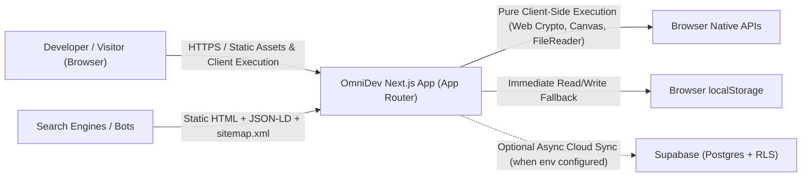

# Application Architecture & Technical Design (`architecture.md`)

- **Phase**: `INCEPTION`
- **Stage**: `Application Design`

---

## 1. High-Level System Architecture



---

## 2. Component Boundaries & Data Contracts

### 2.1 Next.js App Router & Server/Client Isolation
To achieve both **instant SEO indexation** and **100% client-side privacy**, routes follow a strict Server Component + Client Island boundary:

1. **Server Components (Static Generation via `generateStaticParams`)**:
   - `src/app/page.tsx`: Renders global `WebSite` JSON-LD and delegates interactive discovery to `HomeHubClient`.
   - `src/app/categories/[category]/page.tsx`: Statically pre-renders all 6 category routes with `CollectionPage` + `BreadcrumbList` JSON-LD, SEO metadata, and category Bento grid.
   - `src/app/tools/[category]/[slug]/page.tsx`: Statically pre-renders all 24 tool routes with `SoftwareApplication` + `BreadcrumbList` + `FAQPage` JSON-LD, canonical metadata, and mounts `ToolWorkspace`.
   - `src/app/sitemap.ts`, `src/app/robots.ts`, `src/app/manifest.ts`: Automated crawler discovery endpoints (31 sitemap URLs).

2. **Client Components (`'use client'`)**:
   - `src/components/layout/AppShell.tsx` & `CommandPalette.tsx`: Persistent frosted-glass sidebar, top bar, `Cmd+K` / `Ctrl+K` Command Palette, Favorites drawer, theme toggle, and sync status indicator.
   - `src/components/tools/ToolWorkspace.tsx`: Unified Bento wrapper handling Favorites pin, Preset saving/loading, Shareable URL state (`?state=`), active tool suite mounting, How-It-Works Bento card, Technical Reference, FAQ accordion, and Related Tools.
   - `src/components/tools/suites/*`: 6 domain-grouped interactive tool suites (`ImageToolsSuite`, `FileToolsSuite`, `TextToolsSuite`, `ColorToolsSuite`, `CalculatorToolsSuite`, `CheatsheetToolsSuite`).
   - `src/lib/tools/engines/*`: Pure, deterministic TypeScript modules (`image.ts`, `file.ts`, `text.ts`, `color.ts`, `calculators.ts`) plus `src/lib/tools/data/cheatsheets.ts` and `src/lib/tools/registry.ts`.

### 2.2 Supabase Schema & Hybrid Sync Contracts (`supabase/schema.sql`)
1. `tool_metrics` (`tool_id text primary key`, `views bigint`, `uses bigint`, `updated_at timestamptz`) + `increment_tool_metric(p_tool_id, p_field)` RPC.
2. `user_favorites` (`id uuid`, `client_id text`, `tool_id text`, `created_at timestamptz`, unique `(client_id, tool_id)`).
3. `saved_presets` (`id uuid`, `client_id text`, `tool_id text`, `name text`, `payload jsonb`, `created_at timestamptz`).

**Hybrid Fallback Contract**:
- `isSupabaseConfigured()` checks `Boolean(process.env.NEXT_PUBLIC_SUPABASE_URL && process.env.NEXT_PUBLIC_SUPABASE_ANON_KEY)`.
- `useUserWorkspace()` (`src/hooks/useUserWorkspace.tsx`) reads/writes synchronously to `localStorage` first for 0ms UI responsiveness and mirrors asynchronously to Supabase when configured.

### 2.3 Security, Isolation & Failure Modes
- **Zero Payload Exfiltration**: No user tool input, file blob, token, or image is transmitted to Next.js server routes or external services.
- **Security Headers**: `next.config.ts` sets `X-Content-Type-Options: nosniff`, `X-Frame-Options: SAMEORIGIN`, and `Referrer-Policy: strict-origin-when-cross-origin`.
- **Offline / Unconfigured Degradation**: Missing `.env.local` or unreachable Supabase gracefully switches `syncMode` to `'local'` without blocking tool execution.

---

## 3. Multilingual (`i18n`) Architecture Expansion (`en`, `vi`, `ja`, `zh`)

### 3.1 Stateless `i18next` Architecture (Server SSG + Client + Node `tsx`)

```text
src/i18n/
├── config.ts          # SUPPORTED_LOCALES = ['en','vi','ja','zh'], LOCALE_META, localePath(), stripLocalePrefix()
├── detect.ts          # Pure parseAcceptLanguage(), detectBestLocale() (shared by proxy.ts & client fallback)
├── types.ts           # Strict TypeScript contracts for all 4 dictionary namespaces
├── translator.ts      # Synchronous i18next instance (initImmediate: false) + race-free getFixedT(locale) + getBundle(locale)
├── client.tsx         # 'use client' I18nProvider & useI18n() hook (syncs cookie + localStorage + dispatches draft event)
└── locales/
    ├── en/            # common.ts, catalog.ts, tools.ts, cheatsheets.ts, index.ts (canonical schema)
    ├── vi/            # Same 4 typed modules (TypeScript fails build if any key missing)
    ├── ja/            # Same 4 typed modules
    └── zh/            # Simplified Chinese (zh-Hans / zh-CN)
```

- **Server Components (SSG)**: Call stateless `getFixedT(locale)` / `getBundle(locale)` and registry/cheatsheet helpers (`getLocalizedCategory`, `getLocalizedTool`, `getLocalizedCheatsheetEntries`) without mutating global `i18next.language`, avoiding race conditions during concurrent Next.js static builds.
- **Client Components**: `<I18nProvider locale={locale}>` in `src/app/[locale]/layout.tsx` passes the route `locale` down to `useI18n()` with preloaded synchronous bundles, guaranteeing 0ms hydration parity.
- **Pure Engines & Verification (`scripts/verify-aidlc.ts`)**: `file.ts`, `text.ts`, and `calculators.ts` accept an optional trailing `locale: Locale = 'en'` parameter and call pure `getFixedT(locale)`. `convertBytes()` keeps `'en-US'` numeric formatting so bandwidth arithmetic and assertions remain deterministic across all locales.

### 3.2 App Router `[locale]`, Proxy Redirect, Root `<html>` & SEO Contracts

1. **Request Redirects (`src/proxy.ts`)**:
   - Skips `/_next/*`, `/api/*`, `/sitemap.xml`, `/robots.txt`, `/manifest.webmanifest`, `/favicon.ico`, and asset extensions (`\.[^/]+$`).
   - Passes through paths starting with `/(en|vi|ja|zh)(/|$)`.
   - Redirects `/` and legacy unprefixed paths (`/categories/...`, `/tools/...`) with HTTP `307` using `Cookie (omnidev_locale) → Accept-Language → Default ('en')` while preserving query strings.
2. **Single-`<html>` Root & Localized Layout**:
   - `src/app/[locale]/layout.tsx` exports `generateStaticParams()` for `['en', 'vi', 'ja', 'zh']`, owns `<html lang={LOCALE_META[locale].htmlLang}>` (`en`, `vi`, `ja`, `zh-Hans`), mounts `Inter` + `JetBrains_Mono` (`latin`, `vietnamese`), `UserWorkspaceProvider`, `I18nProvider`, and `AppShell`.
   - `src/app/layout.tsx` and root/localized `not-found.tsx` follow Next.js `16.4.6` conventions (`node_modules/next/dist/docs/`) with zero nested `<html>` tags.
   - Localized routes live under `src/app/[locale]/page.tsx`, `src/app/[locale]/categories/[category]/page.tsx`, and `src/app/[locale]/tools/[category]/[slug]/page.tsx`.
3. **SEO (`src/lib/seo.ts` & `src/app/sitemap.ts`)**:
   - Emits localized `<title>`, `<meta name="description">`, `alternates.canonical`, bidirectional `alternates.languages` (`en`, `vi`, `ja`, `zh-Hans`, `x-default`), OpenGraph `locale` + `alternateLocale`, and JSON-LD with `inLanguage` and localized breadcrumbs/FAQs.
   - `sitemap.ts` outputs `124` entries (`(1 + 6 + 24) * 4`), each with `alternates.languages`.

### 3.3 `sessionStorage` Input Preservation on Locale Switch

- Clicking a locale in `LanguageSwitcher` writes `omnidev_locale` to `localStorage` and Cookie, dispatches synchronous `window.dispatchEvent(new CustomEvent('omnidev:before-locale-switch'))`, and navigates via `router.push()` preserving `?q=` / `?state=`.
- `ToolWorkspace.tsx` listens to `'omnidev:before-locale-switch'` and writes `currentStateRef.current` to `sessionStorage` (`omnidev_locale_draft_${tool.id}`; image `dataUrl` capped at `1_500_000` chars).
- On mount in the target locale, `ToolWorkspace.tsx` restores state with priority `URL ?state= → sessionStorage draft (read + immediate removeItem) → suite defaults`. All 6 suites expose complete state fields via `initialState` / `onStateChange`.
