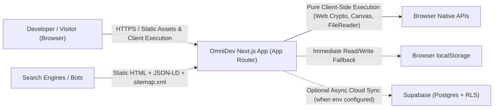

# Application Architecture & Technical Design (`architecture.md`)

- **Phase**: `INCEPTION`
- **Stage**: `Application Design`

---

## 1. High-Level System Architecture



---

## 2. Component Boundaries & Data Contracts

### 2.1 Next.js App Router & Server/Client Isolation
To achieve both **instant SEO indexation** and **100% client-side privacy**, routes follow a strict Server Component + Client Island boundary:

1. **Server Components (Static Generation via `generateStaticParams`)**:
   - `src/app/page.tsx`: Renders global `WebSite` JSON-LD and delegates interactive discovery to `HomeHubClient`.
   - `src/app/categories/[category]/page.tsx`: Statically pre-renders all 6 category routes with `CollectionPage` + `BreadcrumbList` JSON-LD, SEO metadata, and category Bento grid.
   - `src/app/tools/[category]/[slug]/page.tsx`: Statically pre-renders all 24 tool routes with `SoftwareApplication` + `BreadcrumbList` + `FAQPage` JSON-LD, canonical metadata, and mounts `ToolWorkspace`.
   - `src/app/sitemap.ts`, `src/app/robots.ts`, `src/app/manifest.ts`: Automated crawler discovery endpoints (31 sitemap URLs).

2. **Client Components (`'use client'`)**:
   - `src/components/layout/AppShell.tsx` & `CommandPalette.tsx`: Persistent frosted-glass sidebar, top bar, `Cmd+K` / `Ctrl+K` Command Palette, Favorites drawer, theme toggle, and sync status indicator.
   - `src/components/tools/ToolWorkspace.tsx`: Unified Bento wrapper handling Favorites pin, Preset saving/loading, Shareable URL state (`?state=`), active tool suite mounting, How-It-Works Bento card, Technical Reference, FAQ accordion, and Related Tools.
   - `src/components/tools/suites/*`: 6 domain-grouped interactive tool suites (`ImageToolsSuite`, `FileToolsSuite`, `TextToolsSuite`, `ColorToolsSuite`, `CalculatorToolsSuite`, `CheatsheetToolsSuite`).
   - `src/lib/tools/engines/*`: Pure, deterministic TypeScript modules (`image.ts`, `file.ts`, `text.ts`, `color.ts`, `calculators.ts`) plus `src/lib/tools/data/cheatsheets.ts` and `src/lib/tools/registry.ts`.

### 2.2 Supabase Schema & Hybrid Sync Contracts (`supabase/schema.sql`)
1. `tool_metrics` (`tool_id text primary key`, `views bigint`, `uses bigint`, `updated_at timestamptz`) + `increment_tool_metric(p_tool_id, p_field)` RPC.
2. `user_favorites` (`id uuid`, `client_id text`, `tool_id text`, `created_at timestamptz`, unique `(client_id, tool_id)`).
3. `saved_presets` (`id uuid`, `client_id text`, `tool_id text`, `name text`, `payload jsonb`, `created_at timestamptz`).

**Hybrid Fallback Contract**:
- `isSupabaseConfigured()` checks `Boolean(process.env.NEXT_PUBLIC_SUPABASE_URL && process.env.NEXT_PUBLIC_SUPABASE_ANON_KEY)`.
- `useUserWorkspace()` (`src/hooks/useUserWorkspace.tsx`) reads/writes synchronously to `localStorage` first for 0ms UI responsiveness and mirrors asynchronously to Supabase when configured.

### 2.3 Security, Isolation & Failure Modes
- **Zero Payload Exfiltration**: No user tool input, file blob, token, or image is transmitted to Next.js server routes or external services.
- **Security Headers**: `next.config.ts` sets `X-Content-Type-Options: nosniff`, `X-Frame-Options: SAMEORIGIN`, and `Referrer-Policy: strict-origin-when-cross-origin`.
- **Offline / Unconfigured Degradation**: Missing `.env.local` or unreachable Supabase gracefully switches `syncMode` to `'local'` without blocking tool execution.

---

## 3. Multilingual (`i18n`) Architecture Expansion (`en`, `vi`, `ja`, `zh`)

### 3.1 Stateless `i18next` Architecture (Server SSG + Client + Node `tsx`)

```text
src/i18n/
├── config.ts          # SUPPORTED_LOCALES = ['en','vi','ja','zh'], LOCALE_META, localePath(), stripLocalePrefix()
├── detect.ts          # Pure parseAcceptLanguage(), detectBestLocale() (shared by proxy.ts & client fallback)
├── types.ts           # Strict TypeScript contracts for all 4 dictionary namespaces
├── translator.ts      # Synchronous i18next instance (initImmediate: false) + race-free getFixedT(locale) + getBundle(locale)
├── client.tsx         # 'use client' I18nProvider & useI18n() hook (syncs cookie + localStorage + dispatches draft event)
└── locales/
    ├── en/            # common.ts, catalog.ts, tools.ts, cheatsheets.ts, index.ts (canonical schema)
    ├── vi/            # Same 4 typed modules (TypeScript fails build if any key missing)
    ├── ja/            # Same 4 typed modules
    └── zh/            # Simplified Chinese (zh-Hans / zh-CN)
```

- **Server Components (SSG)**: Call stateless `getFixedT(locale)` / `getBundle(locale)` and registry/cheatsheet helpers (`getLocalizedCategory`, `getLocalizedTool`, `getLocalizedCheatsheetEntries`) without mutating global `i18next.language`, avoiding race conditions during concurrent Next.js static builds.
- **Client Components**: `<I18nProvider locale={locale}>` in `src/app/[locale]/layout.tsx` passes the route `locale` down to `useI18n()` with preloaded synchronous bundles, guaranteeing 0ms hydration parity.
- **Pure Engines & Verification (`scripts/verify-aidlc.ts`)**: `file.ts`, `text.ts`, and `calculators.ts` accept an optional trailing `locale: Locale = 'en'` parameter and call pure `getFixedT(locale)`. `convertBytes()` keeps `'en-US'` numeric formatting so bandwidth arithmetic and assertions remain deterministic across all locales.

### 3.2 App Router `[locale]`, Proxy Redirect, Root `<html>` & SEO Contracts

1. **Request Redirects (`src/proxy.ts`)**:
   - Skips `/_next/*`, `/api/*`, `/sitemap.xml`, `/robots.txt`, `/manifest.webmanifest`, `/favicon.ico`, and asset extensions (`\.[^/]+$`).
   - Passes through paths starting with `/(en|vi|ja|zh)(/|$)`.
   - Redirects `/` and legacy unprefixed paths (`/categories/...`, `/tools/...`) with HTTP `307` using `Cookie (omnidev_locale) → Accept-Language → Default ('en')` while preserving query strings.
2. **Single-`<html>` Root & Localized Layout**:
   - `src/app/[locale]/layout.tsx` exports `generateStaticParams()` for `['en', 'vi', 'ja', 'zh']`, owns `<html lang={LOCALE_META[locale].htmlLang}>` (`en`, `vi`, `ja`, `zh-Hans`), mounts `Inter` + `JetBrains_Mono` (`latin`, `vietnamese`), `UserWorkspaceProvider`, `I18nProvider`, and `AppShell`.
   - `src/app/layout.tsx` and root/localized `not-found.tsx` follow Next.js `16.4.6` conventions (`node_modules/next/dist/docs/`) with zero nested `<html>` tags.
   - Localized routes live under `src/app/[locale]/page.tsx`, `src/app/[locale]/categories/[category]/page.tsx`, and `src/app/[locale]/tools/[category]/[slug]/page.tsx`.
3. **SEO (`src/lib/seo.ts` & `src/app/sitemap.ts`)**:
   - Emits localized `<title>`, `<meta name="description">`, `alternates.canonical`, bidirectional `alternates.languages` (`en`, `vi`, `ja`, `zh-Hans`, `x-default`), OpenGraph `locale` + `alternateLocale`, and JSON-LD with `inLanguage` and localized breadcrumbs/FAQs.
   - `sitemap.ts` outputs `124` entries (`(1 + 6 + 24) * 4`), each with `alternates.languages`.

### 3.3 `sessionStorage` Input Preservation on Locale Switch

- Clicking a locale in `LanguageSwitcher` writes `omnidev_locale` to `localStorage` and Cookie, dispatches synchronous `window.dispatchEvent(new CustomEvent('omnidev:before-locale-switch'))`, and navigates via `router.push()` preserving `?q=` / `?state=`.
- `ToolWorkspace.tsx` listens to `'omnidev:before-locale-switch'` and writes `currentStateRef.current` to `sessionStorage` (`omnidev_locale_draft_${tool.id}`; image `dataUrl` capped at `1_500_000` chars).
- On mount in the target locale, `ToolWorkspace.tsx` restores state with priority `URL ?state= → sessionStorage draft (read + immediate removeItem) → suite defaults`. All 6 suites expose complete state fields via `initialState` / `onStateChange`.

---

## 4. Feedback, Ratings & Admin Moderation Architecture (`UNIT-10`–`UNIT-13`)

### 4.1 Privacy-Preserving Supabase RLS & `SECURITY DEFINER` RPC Model (`NFR-08`, `CON-07`)

To keep visitor flows zero-login (`EX-01`) and zero-server-secret (`CON-09`) while preventing anonymous REST clients (`NEXT_PUBLIC_SUPABASE_ANON_KEY`) from reading other users' feedback, contact emails, or comments:

1. **Additive Tables (`supabase/schema.sql`)**:
   - `public.tool_ratings` (`id`, `client_id`, `tool_id`, `rating 1..5`, `comment <= 500`, `created_at`, `updated_at`, unique `(client_id, tool_id)`).
   - `public.feedback_submissions` (`id`, `client_id`, `type in ('feedback','bug','feature')`, `tool_id`, `title <= 140`, `message 10..2000`, `contact_email <= 160`, `debug_context jsonb <= 2KB`, `status in ('open','in_progress','resolved','closed')`, `admin_note <= 1000`, `created_at`, `updated_at`).
   - `public.feedback_admins` (`id`, `user_id` FK `auth.users`, `email` unique) — populated manually via Supabase SQL Editor (with email signups disabled in Supabase Auth Dashboard).
2. **Strict RLS Boundary**:
   - `anon` has **zero `SELECT`/`UPDATE`/`DELETE` policies** on `tool_ratings` and `feedback_submissions`.
   - `anon` may only `INSERT` into `feedback_submissions` with `WITH CHECK` forcing `status = 'open'` and `admin_note = ''`.
   - All anonymous reads and rating upserts go exclusively through pinned `SECURITY DEFINER` RPCs (`set search_path = public`):
     - `get_tool_rating_summaries()` → returns only `(tool_id, avg_rating, rating_count)`.
     - `upsert_tool_rating(p_client_id, p_tool_id, p_rating, p_comment)` → atomic `ON CONFLICT (client_id, tool_id) DO UPDATE`.
     - `get_my_tool_ratings(p_client_id)` → scoped to caller's unguessable UUIDv4 `omnidev_client_id`.
     - `get_my_feedback(p_client_id)` → scoped to caller's `omnidev_client_id` (max 100 recent rows).
   - Admin access is guarded by `is_feedback_admin()` / `check_is_feedback_admin()` (`auth.role() = 'authenticated'`, verified `email_confirmed_at is not null`, and matching `feedback_admins` by `user_id` or `email`).
3. **Isolated Supabase Clients (`src/lib/supabase/client.ts`)**:
   - `getSupabaseClient()` retains `auth: { persistSession: false, autoRefreshToken: false }` for anonymous visitor flows.
   - `getSupabaseAdminClient()` creates an isolated client with `auth: { persistSession: true, autoRefreshToken: true, storageKey: 'omnidev_admin_supabase_auth' }` used solely by `/[locale]/admin/feedback`.

### 4.2 Pure Domain Core (`src/lib/feedback/`) & Client State (`src/hooks/useFeedback.tsx`)

- **`src/lib/feedback/types.ts`**: Shared TypeScript contracts (`FeedbackType`, `FeedbackStatus`, `DebugContextPayload`, `FeedbackSubmission`, `ToolRatingEntry`, `ToolRatingSummary`).
- **`src/lib/feedback/validation.ts`**: Node-executable validation (`FEEDBACK_COOLDOWN_MS = 30_000`, hidden honeypot check, length/email/toolId validation).
- **`src/lib/feedback/debug-context.ts`**: `sanitizePathname()` strips `?query` and `#hash`; `buildSafeDebugContext()` collects only `toolId`, `locale`, stripped `pathname`, `theme`, `viewport`, `platform`, and `userAgentShort` (`<= 120` chars) — never reading `currentStateRef` or `?state=`.
- **`src/lib/feedback/aggregation.ts`**: `aggregateToolRatings()` (1-decimal rounding) and `filterAdminRecords()`.
- **`src/lib/feedback/local-store.ts`**: Safe `localStorage` persistence under `omnidev_tool_ratings`, `omnidev_feedback_submissions`, and `omnidev_feedback_last_submit_at`.
- **`src/hooks/useFeedback.tsx`**: `<FeedbackProvider>` mounted inside `<UserWorkspaceProvider>` in `src/app/[locale]/layout.tsx`, syncing local state immediately and mirroring to Supabase when configured.

### 4.3 Admin Route SEO Isolation (`NFR-10`)

- `src/app/[locale]/admin/feedback/page.tsx` exports `generateStaticParams()` for all 4 locales and `generateMetadata()` with `robots: { index: false, follow: false, nocache: true }`.
- `src/app/sitemap.ts` remains strictly `124` public URLs (no admin routes).
- `src/app/robots.ts` explicitly adds `disallow: ['/*/admin', '/*/admin/*', '/admin', '/admin/*']`.

---

## 5. Device & Network Diagnostics Architecture (`UNIT-14`–`UNIT-17`)

### 5.1 Hybrid Client Hardware + Self-Hosted Speed Test Topology

```text
Browser Client ('use client')
  ├── DiagnosticsToolsSuite.tsx (routes toolId -> 4 modular panels)
  │     ├── KeyboardTesterPanel.tsx  ──▶ KeyboardEvent (capture) + Web Audio click (muted default)
  │     ├── MicTesterPanel.tsx       ──▶ navigator.mediaDevices + AnalyserNode Canvas + MediaRecorder (<=15s)
  │     ├── SpeakerTesterPanel.tsx   ──▶ ChannelMergerNode(2) + DynamicsCompressorNode + setSinkId
  │     └── SpeedTestPanel.tsx       ──▶ fetch() ReadableStream (DL) + XHR upload.onprogress (UL) + localStorage history
  │
  ├── Pure Engine: src/lib/tools/engines/diagnostics.ts (Node/tsx-executable, zero DOM/WebAudio globals)
  │
  └── Same-Origin API Routes (Next.js Runtime: nodejs, force-dynamic, bypassed by src/proxy.ts):
        ├── GET  /api/speedtest/ping     ──▶ 2-byte 'ok', no-store
        ├── GET  /api/speedtest/download ──▶ incompressible xorshift32 Uint8Array, clamp 64KiB..4MiB, no-transform
        └── POST /api/speedtest/upload   ──▶ stream byte counter, abort + 413 if > 4MiB, zero RAM/disk retention
```

### 5.2 Safety, Isolation & SEO Boundaries
1. **Shortcut Coexistence (`NFR-13`)**: `AppShell.tsx` checks `if (e.defaultPrevented) return;` before opening `CommandPalette` on `Cmd/Ctrl+K`, allowing `KeyboardTesterPanel` in Capture Mode (`capture: true`) to intercept browser shortcuts while guaranteeing escape via `Esc × 2` (`<= 600ms`) or Unlock button.
2. **Audio Lifecycle & Hearing Safety (`NFR-12`, `NFR-14`)**: `MicTesterPanel` and `SpeakerTesterPanel` centralize teardown in `useEffect` cleanup + Stop handlers (`track.stop()`, `AudioContext.close()`, `URL.revokeObjectURL()`, `cancelAnimationFrame`). `SpeakerTesterPanel` defaults to `35%` volume behind a `DynamicsCompressorNode` limiter (`-3 dBFS`, `12:1`).
3. **Crawler & Abuse Protection (`NFR-15`, `NFR-16`)**: `src/app/robots.ts` adds `'/api/*'` to `disallow` so bots do not crawl `/api/speedtest/download`. `src/app/sitemap.ts` expands to `144` URLs (`4 × (1 + 7 + 28)`). `/api/speedtest/upload` enforces same-origin `Origin` vs `Host` validation and `<= 4 MiB` streaming cap.

---

## 6. Brand Assets & Backlink Pages Architecture (`UNIT-18`–`UNIT-21`)

### 6.1 Brand Assets & Metadata Routing Pipeline
```text
scripts/generate-brand-assets.ts (pure Node + node:zlib, 4x MSAA Zinc #09090b + Emerald #10b981 ">_")
  ├──▶ src/app/favicon.ico                   (16×16 + 32×32 + 48×48 multi-size ICO)
  └──▶ public/icons/
         ├── icon-192.png                    (192×192 RGBA PNG)
         ├── icon-512.png                    (512×512 RGBA PNG)
         └── icon-maskable-512.png           (512×512 adaptive safe-zone maskable PNG)

Next.js App Router Metadata & Vector Brand Assets:
  ├── src/components/common/BrandLogo.tsx    (Inline React SVG used in AppShell, SiteFooter, About)
  ├── src/app/icon.svg                       (Vector favicon, crisp 16px..512px)
  ├── src/app/apple-icon.tsx                 (180×180 ImageResponse PNG, offline-safe vector JSX)
  ├── src/app/opengraph-image.tsx            (1200×630 ImageResponse PNG via src/lib/brand/og-template.tsx)
  ├── src/app/twitter-image.tsx              (1200×630 ImageResponse PNG via src/lib/brand/og-template.tsx)
  ├── src/app/manifest.ts                    (SVG + 192 + 512 + maskable + ICO, #09090b / #10b981)
  └── src/proxy.ts + shouldBypassLocaleProxy() (skips /apple-icon, /opengraph-image, /twitter-image, /icon.svg, /icon, /favicon.ico, /icons/*, /manifest.webmanifest, /sitemap.xml, /robots.txt)
```
- Delete Next.js starter SVGs in `public/{next,vercel,globe,file,window}.svg`.
- `src/lib/seo.ts` attaches `metadataBase` (`getMetadataBase()`), `openGraph.images` (`/opengraph-image`, `1200×630`), and `twitter.images` (`['/twitter-image']`) to Home, Category, Tool, and Info Page metadata builders.

### 6.2 Site Config, Info Pages Registry & 4-Locale Discovery
- **Centralized Config (`src/lib/site.ts`)**: `resolveSiteConfig(env)` (pure, Node/tsx-testable) & `getSiteConfig()` reading static `process.env.NEXT_PUBLIC_SITE_URL`, `process.env.NEXT_PUBLIC_GITHUB_URL` (default `https://github.com/phungvansyhb/IT-tools`), and optional `process.env.NEXT_PUBLIC_SUPPORT_EMAIL` (validated or `null`).
- **Info Pages (`src/lib/info/pages.ts`)**: `INFO_PAGE_SLUGS = ['about', 'help', 'privacy', 'terms', 'contact']` with Schema.org mapping (`AboutPage`, `FAQPage`, `WebPage`, `ContactPage`), 4-locale `'pages'` namespace (`src/i18n/locales/{en,vi,ja,zh}/pages.ts`), and `164`-URL `sitemap.ts` (`4 × (1 + 7 + 28 + 5)`).
- **UI & Discovery**: Global `<SiteFooter />` mounted inside `.app-main-wrap` below `<main className="app-content">` (`flex: 1`), compact `.sidebar-legal-links` in Sidebar Footer, and `kind: 'page'` entries in `CommandPalette.tsx` (`Cmd/Ctrl+K`). `/[locale]/admin/feedback` remains strictly excluded from public navigation and sitemap.

