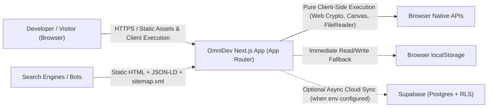

# Application Architecture & Technical Design (`architecture.md`)

- **Phase**: `INCEPTION`
- **Stage**: `Application Design`

---

## 1. High-Level System Architecture

---

## 2. Component Boundaries & Data Contracts

### 2.1 Next.js App Router & Server/Client Isolation
To achieve both **instant SEO indexation** and **100% client-side privacy**, routes follow a strict Server Component + Client Island boundary:

1. **Server Components (Static Generation via `generateStaticParams`)**:
   - `src/app/page.tsx`: Renders global `WebSite` JSON-LD and delegates interactive discovery to `HomeHubClient`.
   - `src/app/categories/[category]/page.tsx`: Statically pre-renders all 6 category routes with `CollectionPage` + `BreadcrumbList` JSON-LD, SEO metadata, and category Bento grid.
   - `src/app/tools/[category]/[slug]/page.tsx`: Statically pre-renders all 24 tool routes with `SoftwareApplication` + `BreadcrumbList` + `FAQPage` JSON-LD, canonical metadata, and mounts `ToolWorkspace`.
   - `src/app/sitemap.ts`, `src/app/robots.ts`, `src/app/manifest.ts`: Automated crawler discovery endpoints (31 sitemap URLs).

2. **Client Components (`'use client'`)**:
   - `src/components/layout/AppShell.tsx` & `CommandPalette.tsx`: Persistent frosted-glass sidebar, top bar, `Cmd+K` / `Ctrl+K` Command Palette, Favorites drawer, theme toggle, and sync status indicator.
   - `src/components/tools/ToolWorkspace.tsx`: Unified Bento wrapper handling Favorites pin, Preset saving/loading, Shareable URL state (`?state=`), active tool suite mounting, How-It-Works Bento card, Technical Reference, FAQ accordion, and Related Tools.
   - `src/components/tools/suites/*`: 6 domain-grouped interactive tool suites (`ImageToolsSuite`, `FileToolsSuite`, `TextToolsSuite`, `ColorToolsSuite`, `CalculatorToolsSuite`, `CheatsheetToolsSuite`).
   - `src/lib/tools/engines/*`: Pure, deterministic TypeScript modules (`image.ts`, `file.ts`, `text.ts`, `color.ts`, `calculators.ts`) plus `src/lib/tools/data/cheatsheets.ts` and `src/lib/tools/registry.ts`.

### 2.2 Supabase Schema & Hybrid Sync Contracts (`supabase/schema.sql`)
1. `tool_metrics` (`tool_id text primary key`, `views bigint`, `uses bigint`, `updated_at timestamptz`) + `increment_tool_metric(p_tool_id, p_field)` RPC.
2. `user_favorites` (`id uuid`, `client_id text`, `tool_id text`, `created_at timestamptz`, unique `(client_id, tool_id)`).
3. `saved_presets` (`id uuid`, `client_id text`, `tool_id text`, `name text`, `payload jsonb`, `created_at timestamptz`).

**Hybrid Fallback Contract**:
- `isSupabaseConfigured()` checks `Boolean(process.env.NEXT_PUBLIC_SUPABASE_URL && process.env.NEXT_PUBLIC_SUPABASE_ANON_KEY)`.
- `useUserWorkspace()` (`src/hooks/useUserWorkspace.tsx`) reads/writes synchronously to `localStorage` first for 0ms UI responsiveness and mirrors asynchronously to Supabase when configured.

### 2.3 Security, Isolation & Failure Modes
- **Zero Payload Exfiltration**: No user tool input, file blob, token, or image is transmitted to Next.js server routes or external services.
- **Security Headers**: `next.config.ts` sets `X-Content-Type-Options: nosniff`, `X-Frame-Options: SAMEORIGIN`, and `Referrer-Policy: strict-origin-when-cross-origin`.
- **Offline / Unconfigured Degradation**: Missing `.env.local` or unreachable Supabase gracefully switches `syncMode` to `'local'` without blocking tool execution.
