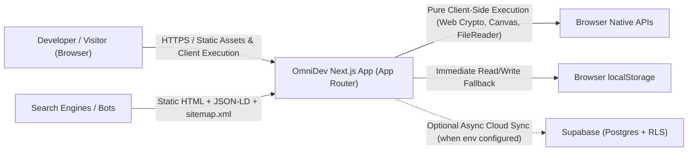

# OmniDev / IT-Tools Hub — Architecture Specification

## 1. System Context (C4 Level 1)

---

## 2. Next.js App Router & Component Boundary Design

To achieve both **instant SEO indexation** and **100% client-side privacy**, routes follow a strict Server Component + Client Island boundary:

1. **Server Components (Static Generation via `generateStaticParams`)**:
   - `src/app/page.tsx`: Renders global `WebSite` JSON-LD and delegates interactive discovery to Client Bento Hub.
   - `src/app/categories/[category]/page.tsx`: Statically pre-renders all 6 category routes with `CollectionPage` + `BreadcrumbList` JSON-LD, SEO metadata, and category Bento grid.
   - `src/app/tools/[category]/[slug]/page.tsx`: Statically pre-renders all 24 tool routes with `SoftwareApplication` + `BreadcrumbList` + `FAQPage` JSON-LD, canonical metadata, and mounts `ToolWorkspace`.
   - `src/app/sitemap.ts`, `src/app/robots.ts`, `src/app/manifest.ts`: Automated crawler discovery endpoints.

2. **Client Components (`'use client'`)**:
   - `AppShell.tsx`: Persistent frosted-glass sidebar, top bar, `Cmd+K` / `Ctrl+K` Command Palette, Favorites drawer, theme toggle, and sync status indicator.
   - `ToolWorkspace.tsx`: Unified Bento wrapper handling Favorites pin, Preset saving/loading, Shareable URL state, active tool suite mounting, How-It-Works Bento card, Technical Reference, FAQ accordion, and Related Tools.
   - `src/components/tools/suites/*`: 6 domain-grouped interactive tool suites (`ImageToolsSuite`, `FileToolsSuite`, `TextToolsSuite`, `ColorToolsSuite`, `CalculatorToolsSuite`, `CheatsheetToolsSuite`).
   - `src/lib/tools/engines/*`: Pure, unit-testable TypeScript modules implementing deterministic algorithms (case conversion, JSON/YAML/CSV, color math & WCAG contrast, chmod, cron, JWT decode, diff, unit/base conversion).

---

## 3. Design System Architecture (Vanilla CSS Tokens)

- `src/styles/tokens.css` & `src/app/globals.css`: Monochrome Zinc Glass + Single Emerald-Mint Accent (`#10B981` in dark mode, `#059669` in light mode).
- `src/styles/glass.css`: Multi-layer `backdrop-filter: blur(16px) saturate(140%)`, specular `1px` inner edge highlights, subtle elevation shadows, and focus rings.
- `src/styles/bento.css`: 12-column responsive Bento Grid system (`.bento-grid`, `.bento-span-12`, `.bento-span-8`, `.bento-span-6`, `.bento-span-4`, `.bento-row-2`) collapsing gracefully at `1024px` (8/4 cols) and `640px` (1 col).

---

## 4. Supabase Schema & Hybrid Sync Architecture

### Database Tables (`supabase/schema.sql`)
1. `tool_metrics`:
   - `tool_id text primary key`
   - `views bigint not null default 0`
   - `uses bigint not null default 0`
   - `updated_at timestamptz not null default now()`
2. `user_favorites`:
   - `id uuid primary key default gen_random_uuid()`
   - `client_id text not null` (anonymous browser UUID or authenticated user ID)
   - `tool_id text not null`
   - `created_at timestamptz not null default now()`
   - `unique (client_id, tool_id)`
3. `saved_presets`:
   - `id uuid primary key default gen_random_uuid()`
   - `client_id text not null`
   - `tool_id text not null`
   - `name text not null`
   - `payload jsonb not null`
   - `created_at timestamptz not null default now()`

### Hybrid Fallback Contract
- `isSupabaseConfigured()` checks `Boolean(process.env.NEXT_PUBLIC_SUPABASE_URL && process.env.NEXT_PUBLIC_SUPABASE_ANON_KEY)`.
- `useUserWorkspace()` always reads/writes synchronously to `localStorage` first for instant 0ms UI feedback.
- When Supabase is configured, mutations mirror asynchronously via `supabase/client.ts` without blocking the UI.
